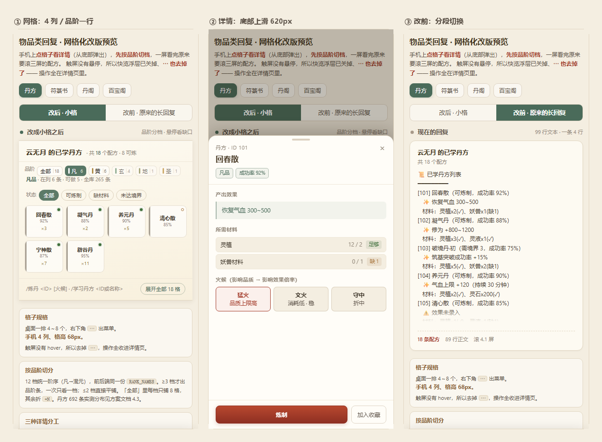

# 物品类回复 · 网格化显示方案

> 目标：丹方、符箓书、丹阁、器阁、百宝阁这类「一堆东西列给你看」的回复，在网页端改成储物戒那样的小格；
> 一格放一个物品，一排放 6～8 个；明细靠悬停 / 点击 / 右上角三点展开。
>
> 本文只回答三件事：**能不能做、怎么做、做完长什么样**。
> 预览：`docs/_grid_preview.html`（可交互）· `docs/_grid_preview.png`（静态图）

---

## 一、结论

**可行，而且是接线不是重做。**

储物戒的网格不是设计稿，是已经上线跑着的代码：`renderItemGrid()` 一身兼了网格、种类/品质筛选、多选批量回收/赠予、悬停浮层、点击菜单、无感刷新六件事（`webchat_room/static/app.js:3104-3377`）。要做的不是重写一套，而是把它从「只认储物戒」松绑成「认任意条目数组」。

真正的成本不在前端，在**后端得先有结构**。目前只有储物戒吐 `entries`（结构化条目数组），丹方/符箓书/商店吐的是拼好的字符串。字符串进不了格子，只能整体当一段文本渲染。

所以方案是两段：

| 段 | 内容 | 判断 |
| --- | --- | --- |
| 后端 | 给 6 处生成函数加一条 `entries` 旁路（原来是 `lines`，现在两者并存） | 数据都在手边，**纯增量**，不动文本、不动结算 |
| 前端 | 抽通用 `renderGrid()`，新增详情面板，卡片分发加 `view: "grid"` | 储物戒那套已有 80%，**改造成本低于重写** |

一个必须先说清的边界：**网格只对网页聊天室生效**。QQ、其他适配器拿不到 HTML，仍然吃 `plain_result` 的文本。因此后端**不能删 `card_lines`**，`entries` 只能旁路并存。这条决定了整个方案的形态——不是「改成小格」，而是「网页端多一种更省地方的看法」。

---

## 二、可行性：手里已经有什么

### 2.1 前端四件套，三件已在用

| 能力 | 位置 | 现状 |
| --- | --- | --- |
| 网格渲染 | `app.js:3104 renderItemGrid()` | 储物戒在用，含筛选/多选/刷新 |
| 悬停浮层 | `app.js:3027 showItemTip()` + `app.css:1232 .item-tip` | 只读结构化字段，**不发请求** |
| 右键菜单 | `app.js:3658 openItemMenu()` + `newCtxMenu()` | 背包动作写死在里（回收/赠予/装备） |
| 详情面板 | 无 | 现在「详情」是发 `/物品信息 <名>` 指令（`app.js:3671`） |

前三个直接可用，第四个要新建——这也是改造里唯一一块「从零写」的东西。

### 2.2 结构通道已经打通

图片卡片的 sidecar 机制本来就支持结构化条目：

```python
# utils/image_generator.py:546-566
"entries": [{k: v for k, v in it.items() if ...} for it in (sec.get("entries") or [])]
```

前端拿到 sidecar 后走 `renderItemGrid`（`app.js:2764-2772`）。也就是说：

> **只要后端在 `sections` 里多塞一个 `entries` 数组，网页端一行 JS 都不用改就能出格子。**

这张门票已经买好了，问题只是没人往里放东西。

### 2.3 数据成熟度：分三级

这是工作量的真实分布：

**A 级 · dict 就在手边，只是被拼成了字符串**

商店四阁共用 `format_pavilion_display(pavilion_name, items)`（`core/shop_manager.py:1415`）。传进来的 `items` 是完整 dict——`type / name / stock / discount / price / data`，格式化函数只是把它们拼成 `1. 回春散方（凡品） - 380灵石(9.5折) · 库存3` 这样的行。

**改法**：在 `for item in group:` 循环里多 append 一个 dict。**不改任何已有逻辑**。

**B 级 · 字段都在循环里，只是没组装**

丹方 `get_available_recipes`（`managers/alchemy_manager.py:850-895`）在循环里已经拿到了 `recipe_id / name / status / success_rate / effect / material_parts / gold_cost / player.gold`，但只 append 了字符串：

```python
card_lines.append(f"[{recipe_id}] {recipe['name']}（{status} · 成功率 {success_rate:.0f}%）")
card_lines.append(f"   · 效果：{effect}")
```

**改法**：同一个循环里多 append 一个 dict，材料从 `self._iter_recipe_materials(recipe)` 拿（已经在遍历）。

符箓书 `build_craft_book`（`managers/talisman_manager.py:335`）结构一样。

**C 级 · 要补字段**

- `quality`（格子左侧色条）：商店侧有 `rank`（`group_items_by_rank` 在用），配方侧品阶藏在 `_recipe_summary` 里，得单独取一次。
- `state`（右上角状态点）：可做 / 缺料 / 未解锁。丹方侧 `status` + 材料对比已有；商店侧不需要（都有货，用折扣标替代）。
- `stock`：商店有，配方没有。

C 级不难，但要逐条查表，是 G2 阶段的主要工作。

### 2.4 三条硬约束（决定方案不能怎么做）

**① 触屏没有 hover。** 网页聊天室手机端占一半。悬停只能当「锦上添花」，主入口必须是点击。所以 `⋯` 不能是唯一出路——**点击格子 = 出详情**，菜单退到 `⋯` 或长按。

**② 「详情」不能发指令。** 现在点物品弹菜单，选「详情」= `dispatchCommand('/物品信息 回春散')`，聊天流里会多一条消息。网格化后一屏 18 个物品，每看一个刷一条，比原来的列表更脏。详情必须**就地展开**。

**③ 数量级不允许一次性铺开。** 丹方实测 692 条、符箓 35 种、商店单阁几十件。储物戒现在没有分页，全靠筛选顶着——692 个 52px 格子约 30 屏，DOM 直接破万。必须加「一屏 24 格 + 加载更多」，并且配方默认只显示可做的那批。

---

## 三、现状盘点：哪些命令要改

按「是否已经是结构化条目」分三档：

| 命令 | 通道 | 现在长什么样 | 数据侧 | 判定 |
| --- | --- | --- | --- | --- |
| `/储物戒` | 看板 | 网格 ✅ | `entries` | **基线**，只改点击行为 |
| `/丹阁` `/符阁` `/器阁` `/百宝阁` | 出图+文本 | 纵向列表（sidecar 提升） | `items` dict（A 级） | 加 `entries` |
| `/坊市` | 出图+文本 | 纵向列表 | `items`（已有） | 可直接复用 |
| `/丹方` `/丹药配方` | 出图+文本 | 长文本，一条 4 行 | `card_lines`（B 级） | 加 `entries` |
| `/符箓书` `/可制符箓` | 出图+文本 | 长文本，一条 2 行 | `card_lines`（B 级） | 加 `entries` |
| `/符箓配方` | 出图+文本 | 按类别分组长文本 | `card_lines`（B 级） | 加 `entries` |
| `/丹药背包` | 纯文本 | 57 行键值面板 | 走 inventory | 加 `entries`（C 级） |
| `/物品信息` | 纯文本 | 单件详情 | — | **不改**，仍是文本 |

合计 10 条命令、6 处后端生成函数。`/物品信息` 保持文本——它是「单件」，没有列表可格。

---

## 四、设计

### 4.1 格子装什么

一个 86×74 的格子只放三行，多了就糊：

```
┌─────────────┐
│ 回春散    ● │  ← 名称（最多 2 行，11.5px）
│    92%      │  ← 状态行（关键数字；符箓带类别「攻击 90%」）
│    ×3    ⋯  │  ← 数值行（数量/价格） + 三点
└─────────────┘
 ↑3px 品阶色条
```

- **左侧色条**：**品阶**色（凡→混元 12 档，见 4.3）。不用图标——配方没有美术资源，现造图标成本高且不统一。**品质不进格子**，它是开炉才摇的成色，进详情页。
- **右上角状态点**：实心绿=可做，空心橙=缺料，灰色=未达境界/未解锁。这是格子唯一能表达「我现在能不能用」的位置，必须有。
- **状态行**：分档之后档名已经在品阶条上，格子不再重复「凡品」；配方只留成功率，符箓留「类别 成功率」（类别是第二筛选层，格子里必须能看见，否则筛了「攻击」却不知道哪格是）。
- **数值行**：配方显示持有数量 `×3`；商店显示价格 `380`（>1 万缩写 `4.8万`），折扣跟在价格后面 `380 9.5折`，**不做右上角标**——会压住 5 字以上的名字。
- **⋯**：悬停才显形，避免每格都挂三个点显得脏。

尺寸理由：`minmax(86px, 1fr)` 在 500px 宽的面板里排 4～5 个（预览原型实测 4 个），在看板满宽里排 8 个。储物戒现在用 `minmax(62px, 1fr)`，5 个字的丹方名（「九转还魂丹」）会被压成省略号，必须放宽到 86。

### 4.2 三种详情，各管一段

| 入口 | 出什么 | 什么时候用 | 实现 |
| --- | --- | --- | --- |
| **悬停** | 2～4 行快览：成功率、价格、效果、缺什么料 | PC 端快速扫 | 复用 `.item-tip`，纯前端，不发请求 |
| **点击** | 右侧详情面板：效果 / 材料清单（够·缺）/ 门槛 / 火候 / 主按钮 | 决定「做不做」 | 新建 `openItemDetail()`，**不发指令** |
| **⋯** | 动作菜单：详情、炼制、收藏 | 次要动作 | 复用 `newCtxMenu`，动作由 `opts` 传入 |

详情面板的字段就是 v4 方案里 `recipe` 块的内容，只是换了皮：

```
回春散                            [×]
凡品 · 成功率 92%
─────────────────────────────
产出效果
  恢复气血 300~500
所需材料
  灵植        12 / 2   [足够]
  妖兽材料     0 / 1   [缺 1]
门槛
  [需境界 3]（红）  [库存 3]（绿）
火候（影响品质 → 影响效果倍率）
  [猛火 品质上限高] [文火 消耗低·稳] [守中 折中]
─────────────────────────────
[      炼 制      ]  [加入收藏]
```

「缺 1」用橙色、「足够」用绿色——这是玩家唯一真正在算的东西，别让它藏在第三层。

### 4.3 按品阶切分

品阶是这套系统里唯一同时满足「有序、有限、玩家天然关心」的维度——12 档，从凡品到混元先天。类别（攻击/防护）无序，状态（可炼/缺料）随材料天天变，只有品阶能同时回答「我现在站在哪」和「再往上还有什么」。

**阶序是后端常量，前端不许自己排。** `rank_rules.RANK_NAMES` 是唯一权威：

```
凡品 → 黄品 → 玄品 → 灵品 → 地品 → 天品 → 皇品 → 圣品 → 帝品 → 道品 → 仙品 → 混元先天
```

`normalize_rank()` 负责把历史遗留的「下品/中品/上品」「阶系」归一。原型初稿我按「凡/下/中/上/极品」写的，那是**旧名，真实数据里已经不存在**——这类错会让排序整体错位，所以前端第一件事是 `RANKS` 常量对齐后端，而不是 `localeCompare`。

#### 实测分布（跑配置算出来的，不是估的）

| 入口 | 总数 | 品阶分布 | 档数 |
|---|---|---|---|
| 丹方 | 692 | 凡 265 · 黄 128 · 玄 59 · 灵 27 · 地 36 · 天 35 · 皇 20 · 圣 38 · 帝 24 · 道 22 · 仙 23 · 混元 15 | 12 |
| 符箓书 | 35 | 凡 8 · 黄 10 · 玄 8 · 圣 9 | 4 |
| 物品库（四阁货源） | 972 | 凡 467 · 黄 252 · 玄 156 · 圣 80 · 帝 17 | 5 |

丹方 692 条**全部**能查到品阶：`pill_rank_of()` 依次查 `pills / exp_pills / utility_pills / items`，`rank_from_level()` 兜底，实测走兜底的是 0 条。

#### 三条交互规则

1. **≥3 档才出品阶条，≤2 档直接平铺。** 四阁一次只刷 10 来件，若只分 2 档还做页签，等于加一行导航只换来一次点击。
2. **品阶条是页签，不是分割线。** 一次只看一档。理由：12 条分割线在 400px 宽的面板里等于 12 次滚动中断，且每档首行常被截半，视觉断裂；页签能顺手承载「这档多少条、几个可做」，分割线不能。
3. **「全部」里每档只铺 8 格，其余折成 `+N`。** 全部是纵览不是清单，265 条凡品铺平就是 44 行，比改造前的文本还长。

#### 默认落哪一档

`defaultRank = 第一个有「可做」条目的档`。不是最低档，也不是最高档——玩家打开配方书的第一诉求是「现在能做什么」，所以直接落在可下手的那一档，往下一档是囤货区，往上一档是目标区。

#### 一个已有实现被浪费了

`shop_manager.format_pavilion_display()`（L1416）早就有 `group_items_by_rank()`，但只对百宝阁生效：

```python
groups = self.group_items_by_rank(items) if pavilion_name == "百宝阁" else [("", items)]
```

「按品阶分组」后端早就做了，只是做成了文本标题 `【皇品区】`，另外三个阁没用上。网格化后这个 `if` 应该删掉：分组交给品阶条，四个阁统一。同理，百宝阁现在的「分区筛选」（皇品区/地品区/玄品区）**就是品阶，不要再做第二套控件**——原型里两套并存时，玩家会问「分区和品阶有什么区别」。

#### 品阶不是品质

两套完全不同的东西，名字都带「品」，最容易混：

| | 品阶 rank | 品质 quality |
|---|---|---|
| 取值 | 凡品 … 混元先天（12 档） | 一般 / 良好 / 极佳 / 大师（4 档） |
| 来源 | 物品或配方里的静态字段 | 本次炼制的成色（`pill_quality.json`） |
| 作用 | 解锁境界、价格区间、稀有度 | 效果倍率 1.0 / 1.15 / 1.35 / 1.6 |
| 何时定 | 配置写死 | 开炉那刻才摇 |

网格左侧竖条画的是**品阶**；详情页里「火候」影响的是**品质**。两者必须分开画，否则玩家会以为「猛火能把凡品炼成玄品」。

#### 12 档配色：5 个色族，不是 12 种颜色

3px 宽的竖条上，12 个互不相干的色相根本分不出来。按 `RANK_TABLE` 的 `tier`(1–5) 分族，同族靠明度区分：

```
tier1 凡 #a8a093
tier2 黄 #b08d4a
tier3 玄 #5f8a6a  灵 #3f9188  地 #7d7f45
tier4 天 #4a7ba8  皇 #7a6ab0  圣 #b8862b  帝 #a33b2a
tier5 道 #8d939b  仙 #c9a227  混元 #5c4a6e
```

### 4.4 分页与筛选

- 每屏 24 格（桌面 6 列 × 4 行；手机 4 列 × 6 行），底部「加载更多」；单档超过 24 条才分页，凡品 265 条是唯一需要翻页的档。手机 DOM 上限压到 120（桌面 200）。
- 筛选 chip 复用储物戒那排 `.fchip`，做**第二层**：配方按「全部 / 可炼制 / 缺材料 / 未达境界」，符箓按类别（攻击/防护/增益/探索），商店按「全部 / 有货 / 折扣」。
- 两层各有前缀标签（`品阶` / `状态` 或 `类别`），否则两个「全部」并排，玩家不知道哪个管什么。
- **不按类别在网格里插分组标题**。试过了：`grid-column: 1/-1` 会让每组只排一行 4 格，14 个符箓反而占了 8 行高度，比原来的列表还长。类别用 chip 切换，网格保持连续。

### 4.5 降级链

```
有 entries → 网格
无 entries 但有 items → 现有纵向列表（不动）
都没有 → 原文文本
```

三级都在，任何一层挂了都能退到下一层。这也是为什么后端只能加 `entries`、不能删 `lines`。

### 4.6 移动端：四条前提全部不同

这一节是后补的，起因是初稿只在验收里写了一句「<640px 三列」。查了 `app.css` 才发现，**手机上的面板形态和桌面不是同一套**：

```css
/* app.css:2228 起，≤900px */
.main { grid-template-columns: 1fr; }          /* 双栏塌成单栏 */
.panel-pane {
  position: fixed; left: 0; right: 0;
  bottom: calc(52px + var(--safe-b));
  height: 76dvh;                               /* 底部抽屉，满宽 */
  border-radius: 16px 16px 0 0;
}
.panel-tabs { display: none; }                 /* 面板内 tab 条隐藏，改底部导航切换 */
```

所以「384px 窄栏、一排 6 个」这个推算**在手机上不成立**。四条前提逐一不同：

| | 桌面 | 手机（≤900px） |
| --- | --- | --- |
| 面板形态 | 右栏 384px 固定宽 | 满宽底部抽屉，76dvh 高 |
| 可用宽度 | 384 - 38 = 346 | 390 - 24 = 366（满宽） |
| 列数 | 4 列（86px 起） | **4 列等分**，每格 87px |
| 详情 | 栏内 / 右侧滑出 | **底部上滑**，上方留 64px 露出格子 |
| 快览 | 悬停浮层 | **没有**（触屏无 hover） |
| 动作菜单 | 右下 `⋯` | **去掉**（见下） |

#### 4.6.1 三条「触屏没有」的连锁后果

**一，快览浮层在手机上必须关掉。** 现有实现（`app.js:3058`）只绑了 `mouseenter` / `mouseleave`：

```js
el.addEventListener("mouseenter", () => { itemTipTimer = setTimeout(() => showItemTip(entry, el), 140); });
el.addEventListener("mouseleave", hideItemTip);
```

触屏 tap 会**假触发** `mouseenter`，而 `.item-tip` 是 `pointer-events:none`，收不到 `mouseleave` —— 浮层会一直粘在屏幕上，只能靠滚动或下一次点击清掉。这是**现存 bug**，储物戒现在在手机上就有这个问题。修法按**能力**判断而不是按屏宽：

```js
const HAS_HOVER = window.matchMedia("(hover: hover) and (pointer: fine)").matches;
```

触屏丢了快览，补偿办法是**把浮层里的核心信息压进格子**：手机端第二行必须是「类别 + 关键数字」（`攻击 90%` / `库存 5`），第三行是价格或持有量。桌面可以靠悬停才看，手机必须一眼看到。

**二，`⋯` 在手机上要去掉，不是「常显」。** 第一反应是「触屏没有 hover，那就让它常显」，算一下不成立：格子 87px 宽，`⋯` 热区按无障碍最小 28px 算，占掉右下 1/9 面积，且紧贴「点开详情」的热区，误触率高。更关键的是**它提供的能力详情页里全都有**（主按钮 + 次按钮）。所以手机端删掉 `⋯`，只留一条路径：点格子 → 详情页。

**三，详情不能叠两层抽屉。** 手机上 `.panel-pane` 本身已经是底部抽屉，详情若也从底部弹，就是抽屉叠抽屉。两种处理：

- 详情作为 `.panel-pane` **内部覆盖层**（`position:absolute; inset:0`），带 `←` 返回 —— 只一层；
- 或详情作为 `.panel-pane` 的**兄弟层级**，`z-index` 压在上面，`height: calc(76dvh - 64px)`，顶部露 64px 让用户看见自己点的是哪一格。

原型用的是第二种（`620px` + `max-height: calc(100dvh - 64px)`），因为「能看见上面的格子」对「我刚才点的是哪个」这件事很关键。

#### 4.6.2 尺寸与安全区

```css
@media (max-width: 600px) {
  .grid { grid-template-columns: repeat(4, minmax(0, 1fr)); gap: 6px; padding: 10px 12px 12px; }
  .gcell { min-height: 68px; }                       /* 桌面 74px，手机压到 68px 换一行 */
  .gcell .gn { font-size: 11px; -webkit-line-clamp: 2; }  /* 5 字丹方名占两行 */
  .d-foot { padding: 11px 15px calc(11px + env(safe-area-inset-bottom)); }
  .sheet-foot { padding-bottom: calc(11px + env(safe-area-inset-bottom)); }
}
```

- `minmax(0, 1fr)` 不能省。裸 `1fr` 等于 `minmax(auto, 1fr)`，会被内容 min-content 撑破 —— 原型里 `.notes` 和 `.split` 各踩了一次，表现为整页右侧被裁。
- 底部按钮必须让开 home indicator，项目已有 `--safe-t` / `--safe-b`（`app.css:108`），直接复用，不要写死 `12px`。
- 输入框若进详情页（炼丹次数、购买数量），**字号必须 ≥16px**，否则 iOS 聚焦时自动放大页面。项目在 `.composer textarea` 上已经这么做了（`app.css:2308`），详情页要跟进。

#### 4.6.3 品阶条：横滑改折行

13 个 chip（`全部` + 12 档）在 366px 内横滑要滑 1.5 屏，而移动端**没有可见滚动条**，「滑不到头」等于「不知道还有几档」。改折行，`flex-wrap: wrap`，丹方 12 档实测折 2 行，`/符箓书`4 档、`/百宝阁`3 档都只占 1 行。多占 26px 高度，比藏掉一半档位划算。

配套把 chip 收紧到 `padding: 4px 6px; font-size: 11px` —— 不收紧的话丹方会折 3 行。

#### 4.6.4 对比布局在手机上不成立

原型是左右并排「改前 / 改后」，390px 下并排等于两栏各 170px，什么都看不清。手机端改成**分段控件**（`改后 · 小格` / `改前 · 原来的长回复`），一次看一个。这条只影响原型，不影响产品——产品里没有「改前」。

#### 4.6.5 对照图



从左到右：网格（4 列 / 品阶一行 / 无 `⋯`）、详情（底部上滑 620px，上方露出格子）、改前（分段切换）。均为 390×844。


---

## 五、与 v4 方案的关系

前几轮的 v4 方案（`呈现层设计方案v4_视图契约与全命令改造.md`）为配方页设计了一个 `recipe` 原子块：

```json
{"kind":"recipe","output":{...},"effect":"...","materials":[...],"gates":[...],"fire":[...]}
```

这次不冲突，是上下半场：

- `recipe` 是**数据契约**：一次查询该返回什么字段。
- 网格是**视图**：这些字段怎么摆。

格子是 `recipe` 的**列表态**（一行显示 18 个），详情面板是 `recipe` 的**单条态**（展开看树）。两者字节是同一份。

所以顺序上建议先做本方案（G1→G2），v4 的 P0 配方组就只剩「数据字段补齐」这一件事，样式层不用再返工。

---

## 六、改造清单

### 6.1 后端（6 处，全部是「加一个 append」）

| 文件 | 函数 | 行 | 改法 |
| --- | --- | --- | --- |
| `core/shop_manager.py` | `format_pavilion_display` | 1415 | 循环内 append `{name, kind, rank, price, stock, discount, effect}`；另出一个 `build_pavilion_entries()` 供 handler 用 |
| `managers/alchemy_manager.py` | `get_available_recipes` | 826 | 循环内 append `{id, name, rank, rate, state, effect, materials, cost, held}`；返回值加第 5 项 `entries` |
| `managers/talisman_manager.py` | `build_craft_book` | 335 | 同上，材料来自 `resolve_craft_params` |
| `managers/talisman_manager.py` | `build_recipe_page` | 505 | 按 category 出 entries，`effect` 取 `_effect_text` |
| `handlers/alchemy_handlers.py` | `handle_recipes` | 55 | `sections=[{"name":"已学丹方","lines":card_lines,"entries":entries}]` |
| `handlers/pill_handler.py` | `handle_show_pills` | 1650 | 背包走 inventory，出 entries（C 级，最后做） |

关键约束：**`card_lines` 原样保留**，`msg` 原样保留。QQ 端零变化。

品阶字段专门交代一句，因为它决定 4.3 能不能落地：

| 入口 | 品阶从哪来 | 现状 |
| --- | --- | --- |
| 商店四阁 | `item['rank']` 已在 dict 里 | ✅ 现成 |
| 符箓书 / 符箓配方 | `config/talisman_recipes.json` 的 `rank` | ✅ 现成，`build_craft_book` 循环里就在手上 |
| 丹方 | `alchemy_manager._pill_rank_of(output_pill, recipe)` | ⚠️ 函数有、没人用，`get_available_recipes` 的 rows 里缺这个键 |
| 物品库 | `items.json` 的 `rank` | ✅ 现成（972 条里 0 条缺 rank） |

所以后端**只多一行**：丹方的 row 里补 `"rank": self._pill_rank_of(output_pill, recipe)`。另外把 `format_pavilion_display` 里那句 `if pavilion_name == "百宝阁"` 删掉——分组交给品阶条，四个阁统一。

### 6.2 前端（约 400 行，新增 250）

| 改动 | 位置 | 说明 |
| --- | --- | --- |
| 抽 `renderGrid(entries, opts)` | 从 `app.js:3104` 提取 | 参数化 `{filters, primary, onPick, paging}`；储物戒调它时传背包动作 |
| cell 动作参数化 | `app.js:3316 cell()` | 现在硬编码 `openItemMenu`，改成 `opts.onPick(it, ev)` |
| 新增 `openItemDetail(entry)` | 新函数 | 右侧抽屉 + 遮罩，含材料/门槛/火候/主按钮；ESC 关闭 |
| 卡片分发加分支 | `app.js:2270` | `if (card.view === "grid") body.appendChild(renderGrid(card.items, card.gridOpts))` |
| 分区判断放宽 | `app.js:2764` | 现在只认「物品清单/物品栏」，加 `sec.view === "grid"` |
| 新增 `renderRankbar(entries)` | 新函数 | 按 `RANKS` 顺序统计档位，≥3 档才渲染；≤2 档隐藏；`全部` 每档上限 8 格 |
| 分页 | `renderGrid` 内 | 首屏 24，`加载更多`追加，DOM 上限 200 |
| 移动端基座 | `.panel-pane` @900px | 面板已是满宽底部抽屉，网格直接吃满宽，**不要**按 384px 算列 |
| 移动端格子 | CSS @600px | 4 列 `minmax(0,1fr)`、格高 68px、名称 11px 两行 |
| 触屏去 hover | `app.js:3050` cell 绑定 | 加 `HAS_HOVER = matchMedia('(hover: hover) and (pointer: fine)')`，false 时不绑 `mouseenter`；**顺带修掉储物戒浮层粘屏的现存 bug** |
| 触屏去 `⋯` | `app.js:3316` cell() | `@media (hover:none)` 下 `.more{display:none}`；能力全在详情页 |
| 详情方向 | `openItemDetail` | `≤600px` 改底部上滑：`height:620px; max-height:calc(100dvh - 64px); border-radius:16px 16px 0 0` |
| 品阶条折行 | `renderRankbar` 的 CSS | 手机 `flex-wrap:wrap`（横滑在触屏没有可见滚动条，等于隐藏半数档位） |
| 安全区 | `.d-foot` / `.sheet-foot` | `padding-bottom: calc(11px + env(safe-area-inset-bottom))`，复用现有 `--safe-b` |

前端有个会复现的坑：`.gcell{display:flex}` 会压过 `[hidden]` 的默认 `display:none`，筛选代码 `el.hidden = true` 视觉上毫无变化。必须补一条 `[hidden]{display:none !important}`（或筛选改用 `classList.add("is-hide")`）。原型里踩过一次，所以测试要断言「筛选后可见格子数」，不能只测判断逻辑。

### 6.3 测试

- `tests/test_card_sidecar_entries.py` 已有：entries 规范化、丢字段、空条目 → 复用
- 新增 `tests/test_grid_entries_payload.py`：四阁 entries 字段齐全、丹方 entries 数量等于配方数、缺料标记正确、`lines` 未被改动（**这条最重要**，防回归 QQ 端）
- 新增 `tests/test_grid_rank_buckets.py`：丹方 692 条全部有 rank（不许出现空串/未知值）；档位顺序严格等于 `RANK_NAMES`；旧名（下品/中品/上品）经 `normalize_rank` 后必须落进 12 档；符箓 35 条档数 = 4、物品 972 条档数 = 5（分布变了就说明配置被改坏）
- 手工：`/丹方` 学满 30 条后截图对比屏数

---

## 七、分阶段

| 阶段 | 内容 | 出口 |
| --- | --- | --- |
| **G0** | 前端抽 `renderGrid` + 详情面板，**只接储物戒**（数据已有，不用等后端） | 储物戒点击出详情面板，不再刷 `/物品信息` |
| **G1** | 商店四阁 entries（A 级，最容易） | `/丹阁` 出网格，点格子弹购买 |
| **G2** | 丹方 + 符箓书 + 符箓配方 entries + 配方详情（材料/门槛/火候） | `/丹方` 从 4.1 屏降到 1 屏 |
| **G3** | 分页懒加载 + **移动端形态**（4 列 / 底部上滑详情 / 去掉 `⋯` 与悬停）+ `/丹药背包` | 692 条不卡，手机可用 |

G0 单独成阶段的意义：**先验证「详情面板不发指令」这个决策站不站得住**。储物戒是唯一有真实数据的场景，拿它试错成本最低。

---

## 八、不做什么

- **不做图标**。配方没有素材，现造 692 个图标不现实，风格也难统一。文字名 + 品阶色条已经够分辨。
- **不改 `/物品信息`**。单件查询没有列表，格子化无意义。
- **不动结算与存档**。整个方案只加渲染字段，`craft_pill` / `craft_talisman` / `buy` 一行不碰。
- **不在网格里做拖拽排序**。储物戒的多选批量已经是够用的上限。

---

## 九、验收

1. `/丹方` 18 条：文本 4.1 屏 → 网格 1 屏（3 行 × 6），且能一眼看出几条可炼。
2. **品阶切分**：`/丹方` 顶部出品阶条，12 档顺序等于 `RANK_NAMES`；默认落在「第一个可做」的档；切档后网格只留该档；`/丹阁`(3 档) 与 `/符箓书`(4 档) 都出条，只刷 2 档的阁不出条、直接平铺。
3. **百宝阁不再有第二套分区筛选**：`【皇品区】` 那个文本标题消失，只留品阶条。
4. 点任意格子出详情面板，**聊天流不新增消息**。
5. 悬停 150ms 出快览，移开消失，不发网络请求。
6. `/丹方` 在 QQ 通道返回的文本与改动前**逐字一致**（回归）。
7. **390px 手机屏**：面板是满宽底部抽屉，网格 4 列等分（每格约 87px），格高 68px；品阶条折行不横滑（丹方 2 行、符箓/百宝阁 1 行）；点格子出详情从底部上滑、上方留 64px 露出格子；**手机上没有 `⋯`、没有悬停浮层**；详情底部按钮避开 home indicator（`env(safe-area-inset-bottom)`）。
7b. 触屏上连点 5 个格子，**不出现粘住的浮层**（现有 `item-tip` 的假 hover bug 已修）。
8. 692 条满配：首屏 24 格，滚动追加，首屏渲染 < 200ms；凡品 265 条翻页到第 3 页仍不卡。

---

## 十、落地记录（2026-11-13 已实现）

分支 `feat/web-chatroom`。方案里的 G1 / G2 / G3（移动端形态）已全部实现并跑过真实链路验收。

### 10.1 实际改了什么

**后端：只加字段，文本一个字没动**

| 文件 | 改动 |
| --- | --- |
| `utils/image_generator.py` | `render_card()` / `render_card_async()` 新增 `web_sections` 参数，并把分区的 `view` 透传进 sidecar |
| `webchat_room/card_sidecar.py` | 允许「只有 entries 的分区」存活；`view=grid` 时跳过 `_promote_lines_to_items()` |
| `core/shop_manager.py` | 新增 `PAVILION_TYPE_LABELS` 与 `build_pavilion_entries()`（售罄跳过、kind 走标签表、效果取自 `get_trade_details()` 的「描述:/效果:/属性:」） |
| `managers/alchemy_manager.py` | `get_available_recipes()` 返回值 4 项 → 5 项，末尾追加 `entries` |
| `managers/talisman_manager.py` | `build_craft_book()` 3 项 → 4 项；`build_recipe_page()` 加 `web_sections`（说明 + 35 张配方网格） |
| `handlers/shop_handler.py`、`handlers/alchemy_handlers.py`、`main.py` | 接线：位图继续用 `sections`，网页端传 `web_sections` |

**前端**：`app.js` 新增 `renderEntryGrid` / `openEntryDetail` / `openEntryMenu` 等约 560 行；`app.css` 追加 `.eg-*` / `.gcell` / `.ed-*` 约 400 行。

### 10.2 与方案的偏差（都是实测逼出来的）

1. **加了 `web_sections` 旁路**。百宝阁的位图仍要按品阶分成长图，网页端要一整片网格 —— 同一份数据两种排版，共用一个 `sections` 做不到。
2. **`.gcell` 是 `display:flex`，必须补 `[hidden]{display:none !important}`**。`hidden` 属性被 `display:flex` 盖掉，空状态提示会永远露脸。
3. **材料行徽标类名从 `.mk` 改成 `.ms`**。`app.css` 里「行情表」那套 `.mk` 挂了 `container-type: inline-size`，尺寸与内容脱钩，把「缺 1」压成了竖排两行。这个坑不看手机截图根本发现不了。
4. **手机详情抽屉改 `height:auto` + `max-height`**（方案里写死 620px）。三条材料的详情下方会空出半屏，实测难看；内容短就短、长才顶到 `calc(100dvh - 64px)`。
5. **商店条目空效果不再报「效果未录入」**。丹方卷轴/符图本来就没有效果字段，效果在它炼出来的东西上；同时把已被当作效果的「描述:」那一行从明细里剔掉，避免同一句话出现两次。
6. **「门槛」小标题按内容变**：只有库存、没有境界/前置要求时显示「货架」。
7. **`⋯` 改成「有 hover 才生成」**（原来靠 `@media (hover:none)` 隐藏）。按能力而不是按屏宽判断，触屏上连 DOM 都不产生，也就不跟「点开详情」抢热区。

### 10.3 验收实测（真实链路，非静态稿）

| 场景 | 结果 |
| --- | --- |
| `/丹方` | 18 条 → 品阶条 `全部18 \| 凡4 \| 灵5 \| 地3 \| 圣6`；默认落凡品 4 格；桌面 7 列、格 97×74；切灵品 5 格；「全部」纵览 4 档（`凡品 4 条 · 可做 3`…）；点格子出详情「产出效果 / 所需材料 / 火候」，主按钮「炼制」，**新增消息 0 条** |
| `/符箓书` | 10 格、7 列；只有 1 档 → 不出品阶条、直接平铺；详情 3 行材料 + 主按钮「制符」 |
| `/丹阁` | 12 格，3 档（凡 6 / 黄 3 / 混 3）→ 出品阶条；详情「产出效果 / 货架 / 明细」，主按钮「购买」 |
| 390px 手机 | 4 列、格 74×68；品阶条折行 22px；详情抽屉实测 399~499px、`top ≥ 345`（上方露出格子）；`⋯` 不存在 |
| 单测 | `test_grid_entries_payload` 10 项 + `test_grid_rank_buckets` 9 项全过；`test_alchemy_fixes` / `test_recipe_effect_display` / `test_talisman_craft_book` 适配 5/4 元组后全过 |

### 10.4 已知问题 / 未做

- **`/丹药背包` 仍是长文本**（G3 的 C 级剩余项）。
- **丹方卷轴的品阶取的是卷轴物品的 `rank`**：`《回春散·黄方》` 现在落在凡品档，因为 `_inject_recipe_scrolls` 找不到 `回春散·黄` 对应的丹药配置时回落到默认档。属于数据层问题，动它要牵到配置加载，单独处理。
- **触屏分支的验收方式**：桌面 Chrome 的 `Emulation.setEmulatedMedia` 改不动 `(hover: hover)`，所以验收时是在页面脚本前给 `matchMedia` 打桩跑通的（`tests/_manual_grid_shot.py` 的 `HOOK_TOUCH_JS`）。真机行为一致，但这条只能在真机复验。
- 品阶条在 600px 以下折行，13 个 chip 会占 2 行；档位再多就得改回横滑 + 滚动提示。

### 10.5 追加：详情抽屉里的数量步进器（同日）

原来的抽屉只有「炼制 / 制符 / 购买」一个按钮，一次只能做一份；要连做还得关掉抽屉、回到输入框敲 `/炼丹 1 猛火 10`。现在抽屉底部多一行：

```
数量  [−] [ 3 ] [+]   最多 60 颗          [全部 60]
[        炼制 ×3        ]  [关闭]
```

- **上限从后端来**（`entries[].max`）：炼丹取「材料够几次」与「灵石够几次」的最小值；制符用已有的 `possible`；购买取库存，不限量给 `null`。
- **`null` = 算不出来**（如符箓配方总览拿不到背包），此时不画上限、也不出「全部」，只让玩家自己填，超了由后端报错。
- **手输也收**：`inputmode=numeric` + 只留数字，`change`/`blur`/`Enter` 时夹到 `1..max`。
- **`state=lock`（境界/符图没到）不渲染这一行**：按钮本来就是「条件不足」，摆个点不动的步进器只会误导。
- **指令拼装**：`/炼丹 <ID> 猛火 3`、`/制符 烈焰符 3`、`/购买 《炼气丹方》 3`；数量为 1 时不带参数，和老行为完全一致。
- 主按钮文字跟着变（`炼制 ×3`），不必点下去才知道要炼几份。

实测（`python tests/_manual_grid_shot.py recipe|talisman|shop`）：丹方「最多 60 颗」、点两次 `+` → `炼制 ×3`、点「全部 60」→ 加号禁用、手输 2 → ws 帧 `{"text":"/炼丹 1 猛火 2"}`；符箓书「最多 37 张」→ `/制符 烈焰符 2`；丹阁「最多 3 件」→ `/购买 《炼气丹方》 2`。390px 下步进器一行不溢出（`scrollWidth == clientWidth`，主按钮仍有 302px 宽）。

---

## 附录：预览怎么看

打开 `docs/_grid_preview.html`：

- 顶部四个 tab 切命令：丹方 / 符箓书 / 丹阁 / 百宝阁
- 左边是现在的回复原文，右边是改后网格
- **把鼠标放到格子上** → 快览浮层
- **点格子** → 右侧详情面板（效果 / 材料 / 门槛 / 火候）
- **点格子右下角 `⋯`** → 动作菜单
- **顶部「品阶」条** → 切档（凡/黄/玄/地/圣…），点「全部」看分档纵览（每档最多 8 格，多出折 `+N`）
- 第二行筛选 chip 可切「可炼制 / 缺材料 / 未达境界」（符箓是类别，商店是状态）
- 品阶条左侧有「品阶」标签，第二行有「状态 / 类别」标签——两行各管一件事

**手机**：把窗口缩到 600px 以下（或直接用手机打开）：

- 顶部出现 `改后 · 小格` / `改前 · 原来的长回复` 分段控件，一次看一屏（并排在 390px 下不成立）
- 网格变 4 列、格高 68px，**`⋯` 消失、悬停浮层关闭**（触屏没有 hover，硬留会粘屏）
- 点格子 → 详情**从底部上滑 620px**，顶部露出格子便于对照
- 品阶条从横滑改为折行

静态图（设计稿）：`docs/_grid_preview.png`（桌面，丹方场景，1280×880）、`docs/_grid_preview_mobile.png`（三屏 390×844）

**实现后的实拍图**（`python tests/_manual_grid_shot.py recipe|talisman|shop` 起真实 room_server + Chromium 截的，不是设计稿）：

| 文件 | 内容 |
| --- | --- |
| `_grid_1_丹方_桌面.png` | 丹方默认档：品阶条 / 状态筛选 / 4 格，3 个绿点=可炼 |
| `_grid_2_丹方_详情.png` | 右侧详情抽屉：产出效果 / 所需材料 / 火候三档 / **数量步进器（最多 60 颗 + 全部 60）** / 炼制 |
| `_grid_3_切换品阶.png` | 切到灵品页签后只剩 5 格 |
| `_grid_4_全部纵览.png` | 「全部」模式：按品阶分小节，每节带 `N 条 · 可做 M` |
| `_grid_5_筛选可炼制.png` | 状态筛「可炼制」后只剩可做的 |
| `_grid_6_手机.png` | 390px：4 列、品阶条折行、没有 `⋯` |
| `_grid_7_手机详情.png` | 手机底部上滑详情：内容自适应高度，上方露出格子 |
| `_grid_8_符箓书.png` | 符箓书：只有 1 档 → 不出品阶条，类别做二级筛选 |
| `_grid_9_丹阁.png` | 丹阁：3 档出品阶条，名字带书名号要换行 |
| `_grid_10_丹阁详情.png` | 丹阁详情：产出效果 / 货架（库存）/ 明细，数量上限跟库存走，主按钮购买 |
| `_grid_13_符箓书详情.png` | 符箓详情：材料 / 成功率，数量上限「最多 37 张」，主按钮制符 |
| `_grid_11_符箓配方.png` | 符箓配方总览：说明留在上方，35 张合成一片网格，类别做二级筛选 |
| `_grid_12_符箓配方详情.png` | 总览页拿不到背包：材料只写「需 N」，不谎报缺多少 |
